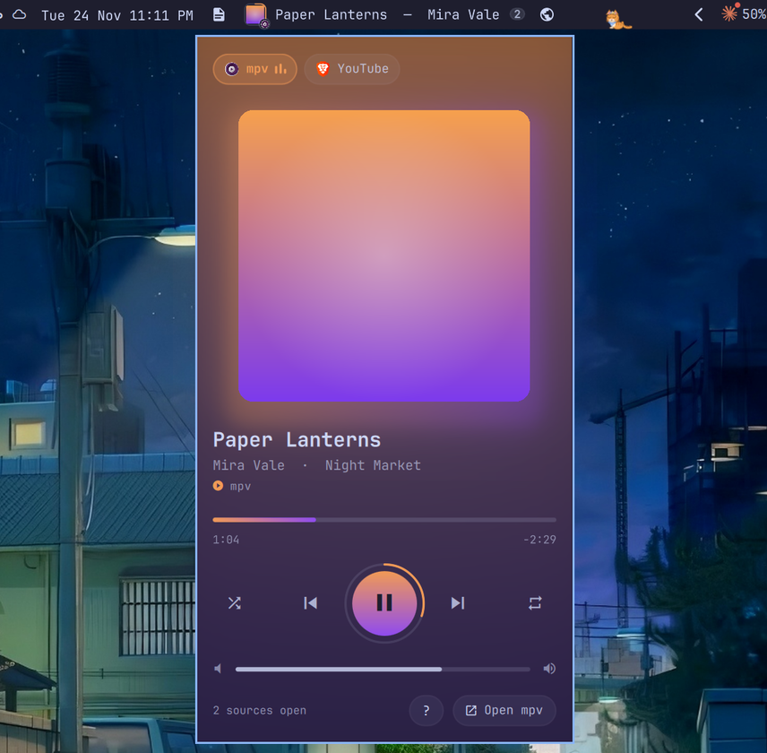
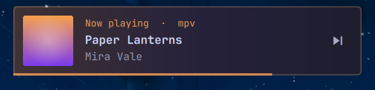
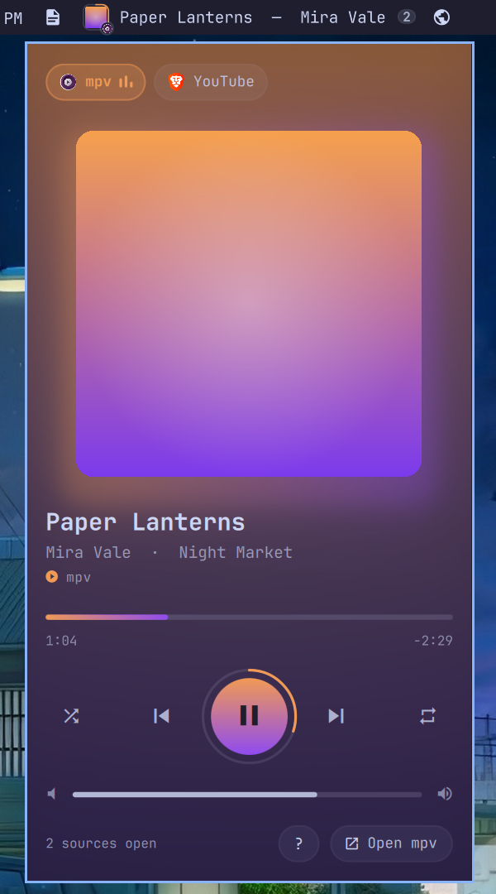

# Now Pulse

Now playing from **every** audio source, in the Omarchy bar: Brave, Zen, Firefox, Chrome, Spotify, mpv, VLC, YouTube Music, and anything else that speaks MPRIS.

A sibling of [Spotify Pulse](https://github.com/iammhador/omarchy-spotify-pulse), for everything that isn't only Spotify.

<p align="center"></p>

## Install

**Requirements**
- Omarchy 4 (Hyprland and the Quickshell-based `omarchy-shell`).
- Any app that plays media over MPRIS: every major browser, Spotify, mpv (with `mpv-mpris`), VLC, and more.
- No accounts, API keys or network access.

```bash
omarchy plugin add https://github.com/iammhador/omarchy-now-pulse.git --enable
```

It lands in the center of the bar. To move it:

```bash
omarchy bar move io.github.iammhador.now-pulse --section center --index 3
```

Using Spotify Pulse too? Set `skipSpotify` so Spotify shows only there:

```bash
omarchy bar set io.github.iammhador.now-pulse skipSpotify true --json
```

A keybinding for the card, in `~/.config/hypr/bindings.lua`:

```lua
o.bind("SUPER + ALT + P", "Now Pulse", "omarchy-shell now-pulse toggle")
```

### Updating

```bash
omarchy plugin update io.github.iammhador.now-pulse
omarchy restart shell
```

## Bar


- The cover (album art, or the video's thumbnail) with the track's progress drawn around it.
- The playing app's icon as a badge on the cover's corner.
- `Title — Artist` with a ping-pong marquee for long titles.
- A small count when more than one source is open.
- Follows whatever started playing most recently, once it has played for 2 seconds, so ads and hover previews don't steal the bar. It never switches while the card is open.
- Names sources by **site**, not app: "YouTube", "Instagram", "TikTok", "Reddit", "Facebook", "WhatsApp", "Dailymotion", "Twitch", "Netflix" and more. An unknown site gets its name from the address ("Poridhi"). Brave and Chrome send no address, so the site is read from the window title.

| Mouse | Action |
|---|---|
| Left click | Open the player card |
| Middle click | Play / pause |
| Right click | Next track |
| Wheel | Volume (or track / source, see settings) |
| Hover | Preview with cover, source and time left |

## Pop-up

When a new track starts, a small card slides in under the bar with the cover, title, artist and where it plays, then slides away after a few seconds. Hover to keep it, click it to open the player card, skip from it, or right-click to dismiss.



It stays quiet when it would get in the way:
- during **Do Not Disturb**,
- over a **fullscreen** window,
- while you're **looking at the playing app** (the video's tab in front),
- while the card is open, and for the same song twice in a row.

Turn it off with `trackToast false`, or change how long it stays with `toastSeconds`.

## Card

<p align="center"></p>

- **A chip per source** across the top, with the app's real icon and bouncing bars while it plays.
  - Click a chip to show that source.
  - Middle-click a chip to play/pause it without switching.
- **Cover:** glows in two colors taken from the art over a blurred backdrop.
  - Square for album art; wide for YouTube thumbnails.
  - Swipe the cover to skip. Double-click it to open the app.
- **Video:** for browsers and video players, the Cover / Video switch replaces the cover with a **live view of the playing window**, and the card widens.
  - Scroll to zoom in on the video, drag to frame it, right-click to reset. The framing is remembered for each app.
  - Click to play/pause; double-click to jump to the app.
  - A Picture-in-Picture window is used when one is open, since it's only the video.
  - If the video plays in a background tab, the card says so. In Zen/Firefox, **Bring it forward** selects that tab and returns you to the workspace you were on. Chromium browsers (Brave, Chrome) can't do this, so switch to the tab yourself.
- **Source line:** shows where the sound comes from, e.g. `YouTube · Zen`, with the platform's glyph.
- **No cover art?** A site's logo is never blown up as the cover. With a confidently matched window the card opens in Video; otherwise it shows a title card with the platform glyph.
- **Honest controls:**
  - Shuffle and repeat are hidden when the source can't do them.
  - Live streams show a LIVE pill instead of a seek bar. A player that simply doesn't share a timeline (Zen and Firefox never do) gets no seek bar and no LIVE pill.
  - Actions a site doesn't support say so ("Can't skip on Instagram") instead of doing nothing.
- **Video is only offered for the right window:** a Picture-in-Picture window, or the window whose tab is this video. When that can't be told, for example a generic title like "Instagram" or the tab sitting in the background, the switch says so instead of mirroring the wrong page.
- **Seek bar:** with a time bubble. Hidden for live streams.
- **Controls:**
  - shuffle · previous · play/pause · next · repeat
  - Controls the app doesn't support are dimmed.
  - The play button has a progress ring.
- **Volume:** shown when the app exposes it.
- **Open app:** focuses the app's window.

| Key | Action |
|---|---|
| Space | Play / pause |
| ← / → | Seek 5 s |
| ↑ / ↓ | Volume |
| 0–9 | Jump to 0 %–90 % |
| N / P | Next / previous |
| S / R | Shuffle / repeat |
| Tab / Shift+Tab | Next / previous source |
| V | Cover / Video |
| O | Open the tab or app |
| ? | Shortcuts |
| Esc | Close |

## Settings

| Key | Default | |
|---|---|---|
| `maxWidth` | 240 | Max text width in the bar |
| `showArtist` | true | Show the artist after the title |
| `marquee` | true | Scroll long titles |
| `showAppIcon` | true | App badge on the bar cover |
| `pillProgress` | true | Progress around the bar cover |
| `scrollAction` | volume | `volume`, `track`, `source` or `none` |
| `showWhenIdle` | false | Show a note when nothing is playing |
| `skipSpotify` | false | Leave Spotify to Spotify Pulse |
| `pauseOthers` | false | Starting one source pauses the rest |
| `coverColors` | true | Theme the card from the cover |
| `blurBackdrop` | true | Blurred cover behind the card |
| `trackToast` | true | Pop-up when a new track starts |
| `toastSeconds` | 4 | How long the pop-up stays (2–15) |

```sh
omarchy bar set io.github.iammhador.now-pulse scrollAction source
omarchy bar set io.github.iammhador.now-pulse trackToast false --json
```

## IPC

Bind these in Hyprland if you like:

```sh
qs ipc call now-pulse toggle        # open / close the card
qs ipc call now-pulse playPause
qs ipc call now-pulse next
qs ipc call now-pulse previous
qs ipc call now-pulse cycleSource   # switch to the next open source
qs ipc call now-pulse volume 60
qs ipc call now-pulse raise         # focus the playing app
qs ipc call now-pulse video         # cover <-> live video view
qs ipc call now-pulse toast         # show the pop-up for what's playing
qs ipc call now-pulse status        # JSON
```

## Notes

- `playerctld` is ignored, since it would show every source twice.
- Players with nothing loaded are hidden.
- Zen and Firefox send no track length or position over MPRIS, so their videos have no seek bar. Play, pause, volume, the cover and the video view all work.
- Firefox-based browsers only report media that makes sound: a muted feed (Instagram, TikTok, Imgur) shows up once you unmute it.
- Chromium-based browsers (Brave, Chrome) expose one player per browser: with two tabs playing, the bar follows the one the browser reports.
- Between two videos (YouTube's autoplay countdown, a click to another video) a browser reports "Stopped" with no title for a moment. The last track is held for up to 12 s so the bar and card don't blink away.
- The video view mirrors the window through the Wayland screencopy protocol, only while the card is open in video mode. The capture stays on your machine.
- Covers served over the web (Spotify) are cached in `~/.cache/now-pulse` for color sampling and pruned after a week. Nothing else is stored or sent anywhere.

## Development

```sh
node tests/model.test.js
python3 tools/fake-player.py          # a fake MPRIS player with made-up tracks
qs ipc call now-pulse demo true       # only show the fake players (for screenshots)
rsync -a --delete --exclude .git ./ ~/.config/omarchy/plugins/io.github.iammhador.now-pulse/
omarchy restart shell
```

MIT © iammhador
